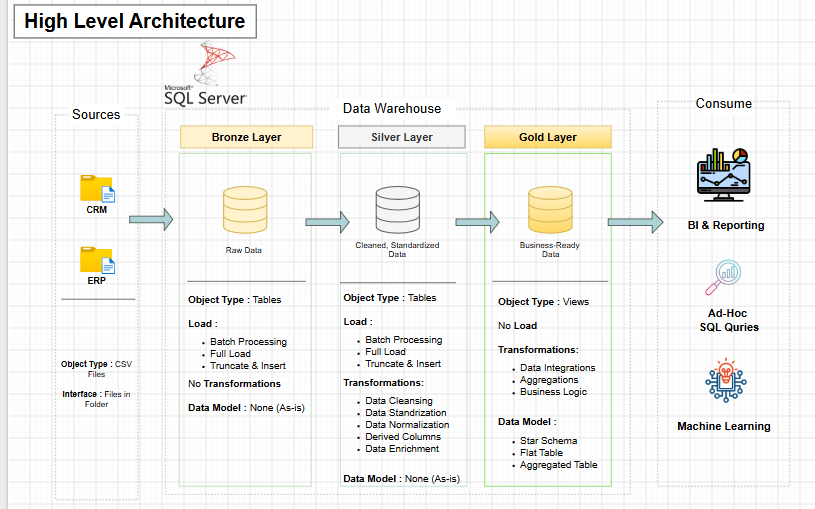
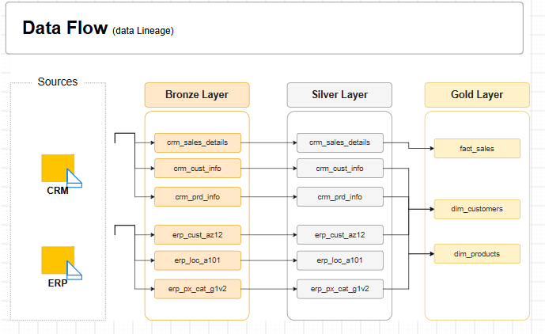
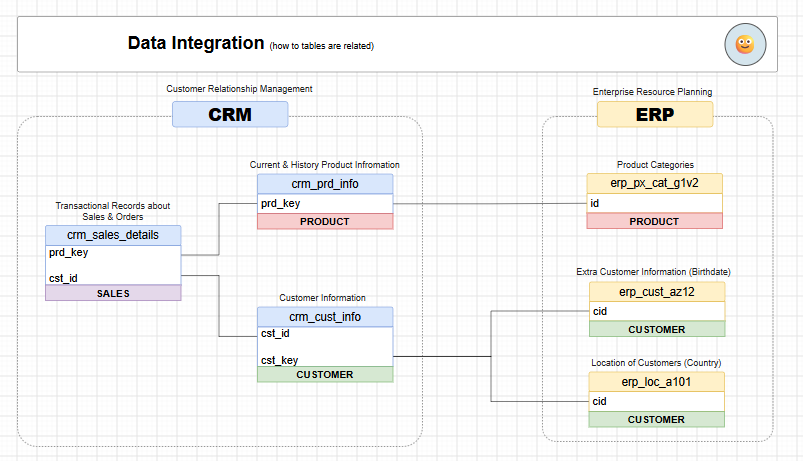
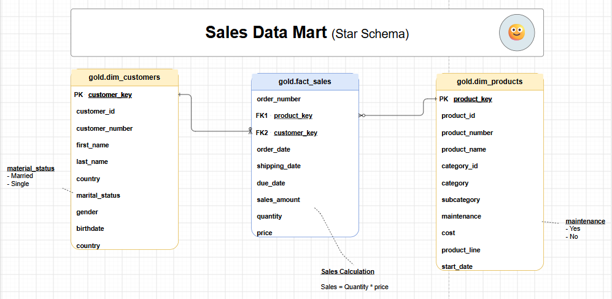

<div align="center">

# SQL Data Warehouse Project

**Building an Analytics-Ready Data Warehouse with SQL Server**

An end-to-end data engineering project that integrates CRM and ERP data through a **Bronze → Silver → Gold** architecture and transforms it into a dimensional model for sales analytics.

[](https://www.microsoft.com/en-us/sql-server)
[](https://learn.microsoft.com/en-us/sql/)
[](#-architecture)
[](LICENSE)

</div>

---

## Overview

This project consolidates CRM and ERP CSV data in SQL Server, prepares it through layered transformations, and structures business-ready data for analytical queries and reporting.

### Key Features
- CRM and ERP source-data integration
- Bronze, Silver, and Gold warehouse layers
- Data cleaning, standardization, and transformation
- Fact and dimension tables using a star schema
- SQL-based customer, product, and sales analysis

## Architecture



| Layer | Purpose |
|---|---|
| **Bronze** | Stores raw source data. |
| **Silver** | Cleans, standardizes, and integrates data. |
| **Gold** | Organizes curated data for reporting and analysis. |

## Data Flow



CRM and ERP CSV files flow into Bronze tables, are prepared in Silver, and are modeled as Gold-layer analytical objects.

## Source Integration



The integration model shows relationships between CRM sales, customer and product data, and ERP customer attributes, locations, and product categories.

## Sales Data Mart



The Gold-layer model centers on `gold.fact_sales` and connects it to two dimensions:

- **`gold.dim_customers`** — customer identifiers and attributes.
- **`gold.dim_products`** — product identifiers, categories, and attributes.

The model includes order, shipping, and due dates, as well as sales amount, quantity, and price.

```text
Sales = Quantity × Price
```

## SQL Analytics

The `Analytics_Scripts/` directory contains numbered SQL scripts covering exploratory and analytical query patterns.

| Script | Focus |
|---|---|
| `01_database_exploration.sql` | Database exploration |
| `02_dimensions_exploration.sql` | Dimension exploration |
| `03_data_range_exploration.sql` | Date and data-range exploration |
| `04_measures_exploration.sql` | Measures and key metrics |
| `05_magnitude_analysis.sql` | Magnitude analysis |
| `06_ranking_analysis.sql` | Ranking analysis |
| `07_change_over_time_analysis.sql` | Trends over time |
| `08_cumulative_analysis.sql` | Cumulative analysis |
| `09_performance_analysis.sql` | Performance analysis |
| `10_part_to_whole_analysis.sql` | Part-to-whole analysis |
| `11_data_segmentation.sql` | Data segmentation |
| `12_report_customers.sql` | Customer reporting |
| `13_report_products.sql` | Product reporting |

These scripts provide a structured set of SQL examples for exploring warehouse data and developing business-focused reports.

## Technology Stack

- **Database:** Microsoft SQL Server
- **Query language:** SQL
- **Source format:** CSV
- **Architecture:** Medallion (Bronze, Silver, Gold)
- **Data modeling:** Star schema
- **Documentation:** Draw.io

## Repository Structure

```text
SQL-DataWarehouse-Project/
├── Analytics_Scripts/  # SQL exploration and analytical queries
├── datasets/           # CRM and ERP source datasets
├── docs/               # Architecture and data-model diagrams
├── scripts/            # Data loading and transformation SQL
├── tests/              # Tests and validation assets
├── LICENSE
└── README.md
```

## Getting Started

### Prerequisites
- Microsoft SQL Server
- SQL Server Management Studio (SSMS) or another SQL client
- Git

### Clone the repository

```bash
git clone https://github.com/pradipta2005/SQL-DataWarehouse-Project.git
cd SQL-DataWarehouse-Project
```

### Explore the project
1. Review the CRM and ERP source files in `datasets/`.
2. Read the architecture and modeling diagrams in `docs/`.
3. Review the loading and transformation scripts in `scripts/`.
4. Run the relevant SQL scripts in dependency order after checking database names and file paths.
5. Explore `Analytics_Scripts/` for analysis queries and customer/product reports.
6. Review `tests/` for available validation instructions.

**Data workflow:** `CRM & ERP CSVs → Bronze → Silver → Gold → SQL Analytics`

> The exact database setup and execution order depend on the SQL scripts in the repository.

## Skills Demonstrated

SQL · Data Warehousing · ETL/ELT · Data Cleaning · Source Integration · Dimensional Modeling · Star Schema · Exploratory Analysis · Analytical Reporting

## About the Author

<div align="center">

**Pradipta Khan**  
*Data Analyst | Data Science Graduate*

<a href="https://github.com/pradipta2005"></a>
<a href="https://www.linkedin.com/in/pradipta-khan/"></a>
<a href="https://pradipta2005.github.io/Mr.-PK/"></a>

</div>

## License

Distributed under the MIT License. See [`LICENSE`](LICENSE) for details.

---

<div align="center">

If you find this project useful, consider giving the repository a ⭐.

</div>
