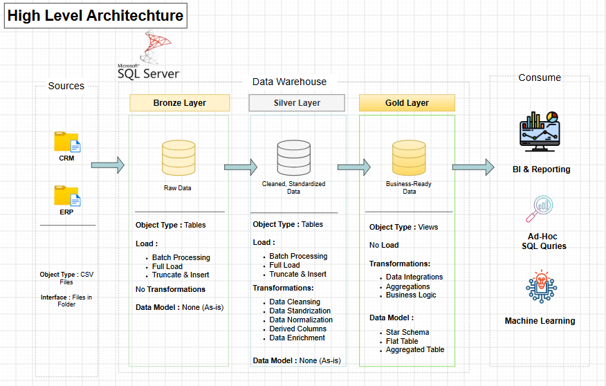

<div align="center">

# SQL Data Warehouse Project

### Building an Analytics-Ready Data Warehouse with SQL Server

A hands-on data engineering project that brings together CRM and ERP data, processes it through a **Bronze → Silver → Gold** architecture, and organizes business-ready information into a **star schema** for sales analytics.

[](https://www.microsoft.com/en-us/sql-server)
[](https://learn.microsoft.com/en-us/sql/)
[](#-data-architecture)
[](LICENSE)

</div>

---

## 📌 Overview

This repository demonstrates an end-to-end SQL data warehousing workflow using two operational source systems:

- **CRM (Customer Relationship Management):** sales transactions, customer information, and product information.
- **ERP (Enterprise Resource Planning):** additional customer attributes, customer location data, and product-category information.

The source data is stored in CSV files and consolidated into a structured warehouse. Data is organized into three layers—Bronze, Silver, and Gold—so that raw ingestion, data preparation, and analytical modeling remain clearly separated.

The final Gold layer is designed for reporting and ad-hoc SQL analysis, with a sales fact table connected to customer and product dimensions.

> **Project focus:** SQL development, ETL/ELT concepts, data quality, source integration, dimensional modeling, and analytical query design.

## ✨ Key Features

- **Multi-source ingestion:** brings CRM and ERP CSV data into a SQL Server warehouse.
- **Medallion architecture:** separates raw, cleaned, and business-ready data.
- **Data cleaning and standardization:** prepares source records for reliable analysis.
- **Cross-system integration:** combines related customer and product information from CRM and ERP.
- **Star-schema modeling:** organizes sales measures around fact and dimension tables.
- **Sales analytics foundation:** supports customer, product, and sales-trend analysis through SQL.
- **Documented data lineage:** diagrams explain the architecture, flow of data, integrations, and analytical model.

## 🏗️ Data Architecture

The warehouse follows the **Medallion Architecture** pattern.



### Bronze — Raw Data

- Loads source CSV files from CRM and ERP.
- Retains source data in a raw, as-is form.
- Uses tables as the storage objects.
- Provides the starting point for downstream transformations.

### Silver — Cleaned and Standardized Data

- Applies data-cleaning and standardization steps.
- Normalizes and enriches records where required.
- Integrates related information from source systems.
- Produces consistent data for analytical modeling.

### Gold — Business-Ready Data

- Exposes curated data for reporting and analysis.
- Applies business logic, integrations, and aggregations where required.
- Uses dimensional models, including a star schema, to simplify analytical queries.

### Data Consumers

The Gold layer is intended to support:

- Business intelligence and reporting
- Ad-hoc SQL queries
- Downstream machine-learning or advanced-analytics workflows

These are intended consumption use cases; separate BI dashboards or machine-learning models are not implied unless implemented elsewhere in the repository.

## 🔄 Data Flow and Lineage

The data flow diagram shows how the CRM and ERP source files move through the Bronze and Silver layers before being organized into Gold-layer analytical objects.


At a high level:

1. **Source:** CRM and ERP CSV files provide operational data.
2. **Bronze:** source records are loaded into raw tables.
3. **Silver:** records are cleaned, standardized, and prepared for integration.
4. **Gold:** curated data is organized into analytical fact and dimension objects.
5. **Consumption:** the resulting model supports reporting and SQL analysis.

## 🔗 Data Integration

CRM and ERP contain different pieces of related business information. Integration connects those records so that customers, products, and sales can be analyzed together.


The illustrated relationships include:

- CRM sales details linked to CRM customer information.
- CRM product information represented through product keys.
- ERP product-category information linked through product identifiers.
- ERP customer attributes and location information associated with customer identifiers.

The integration diagram documents the intended relationships between the source entities. The actual join logic and transformation rules are defined by the SQL scripts in the repository.

## ⭐ Sales Data Mart — Star Schema

The Gold-layer sales model is designed around a central sales fact table and descriptive dimensions.


### Fact Table

**`gold.fact_sales`** — stores sales-level measures and transaction dates, with keys connecting each record to its dimensions.

Fields shown in the model include:

- `order_number`
- `product_key`
- `customer_key`
- `order_date`
- `shipping_date`
- `due_date`
- `sales_amount`
- `quantity`
- `price`

### Dimension Tables

**`gold.dim_customers`** — provides descriptive customer attributes, such as customer identifiers, name, country, marital status, gender, and birthdate.

**`gold.dim_products`** — provides product attributes, such as product identifiers, name, category, subcategory, maintenance flag, cost, product line, and start date.

### Sales Measure

The model diagram documents the sales calculation as:

`Sales = Quantity × Price`

The precise implementation and any additional business rules should be verified in the relevant SQL transformation scripts.

## 🧰 Technology Stack

| Technology / Concept | Purpose |
|---|---|
| Microsoft SQL Server | Relational database and warehouse platform |
| SQL | Data loading, transformation, modeling, and analysis |
| CSV | Source-data format for CRM and ERP |
| Medallion Architecture | Separation of raw, prepared, and curated data |
| Dimensional Modeling | Fact and dimension tables for analytical queries |
| Draw.io | Architecture, lineage, integration, and data-model diagrams |

## 📂 Repository Structure

The repository currently contains the following top-level structure:

```text
SQL-DataWarehouse-Project/
├── datasets/       # Source datasets used by the project
├── docs/           # Project documentation and diagrams
├── scripts/        # SQL scripts for warehouse operations
├── tests/          # Tests and validation assets
├── LICENSE         # Project license
└── README.md       # Project documentation
```

The diagrams linked in this README are provided in the accompanying `docs/` folder. Keep the image filenames unchanged, or update the Markdown image paths if you choose different names.

## 🚀 Getting Started

### Prerequisites

- Microsoft SQL Server (a local or hosted instance)
- SQL Server Management Studio (SSMS) or another SQL client
- Git, if you want to clone the repository

### 1. Clone the repository

```bash
git clone https://github.com/pradipta2005/SQL-DataWarehouse-Project.git
cd SQL-DataWarehouse-Project
```

### 2. Review the project files

- Inspect `datasets/` to identify the available CRM and ERP source files.
- Review `docs/` to understand the architecture and data model.
- Open `scripts/` and follow the SQL scripts in the order appropriate to their dependencies.
- Review `tests/` for available validation or testing instructions.

### 3. Prepare SQL Server

1. Start your SQL Server instance.
2. Open the project SQL scripts in SSMS.
3. Review the database names, schema names, file paths, and connection assumptions used by the scripts.
4. Update any environment-specific paths or database settings before execution.

### 4. Load and transform the data

Follow the scripts included in the repository to execute the available loading and transformation workflow. Conceptually, the expected layer progression is:

`Source CSV files → Bronze → Silver → Gold`

Run scripts in dependency order. The exact execution commands, database setup, and script sequence should follow the implementation in `scripts/`.

### 5. Validate the output

Use the available tests in `tests/` and SQL queries to check that:

- Expected source data has been loaded.
- Cleaning and standardization rules behave as intended.
- CRM and ERP relationships are joined correctly.
- Fact and dimension keys match the intended model.
- Sales measures and analytical results are consistent with the implemented business rules.

> **Note:** This README describes the project based on the repository structure and supplied diagrams. It does not assume a specific script filename, database name, automated test command, or successful execution result where those details are not documented here.

## 📊 Analytics Use Cases

The modeled data is suitable for exploring questions such as:

- How do sales change over time?
- Which products or product categories contribute most to sales?
- How are sales distributed across customers and countries?
- What customer attributes can be used to segment sales?
- How can transaction-level data be summarized for reporting?

These are analysis opportunities enabled by the model, not claims of precomputed findings or included dashboards.

## 🧪 Testing and Data Quality

Data quality is an important part of the warehouse workflow. Review the project’s `tests/` directory for the checks implemented in this repository.

Useful validation areas include:

- Null or missing values in important fields
- Duplicate business keys or records
- Invalid dates and inconsistent formats
- Unmatched CRM-to-ERP records
- Missing fact-to-dimension relationships
- Reconciliation of sales amounts and quantities

Only checks that are actually implemented in the repository should be described as automated tests.

## 🗺️ Project Documentation

| Diagram | Description |
|---|---|
| `docs/architecture.png` | High-level Bronze, Silver, and Gold architecture |
| `docs/data-flow.png` | Data lineage from source systems through warehouse layers |
| `docs/data-integration.png` | Relationships between CRM and ERP entities |
| `docs/data-model.png` | Gold-layer sales star schema |

## 🎯 Skills Demonstrated

- SQL and relational database concepts
- Data warehouse architecture
- ETL/ELT workflow design
- Data cleaning and standardization
- CRM and ERP source integration
- Fact and dimension modeling
- Star schema design
- Data lineage and technical documentation
- Data quality and analytical validation


👨‍💻 About me


<div align="center">

Pradipta Khan

Data Analyst | Data Science Graduate | SQL & Data Engineering Enthusiast

Turning raw data into meaningful insights through data analytics, engineering, and visualization.

<br/>

<a href="https://github.com/pradipta2005">
  
</a>
<a href="YOUR_LINKEDIN_URL">
  
</a>
<a href="YOUR_PORTFOLIO_URL">
  
</a>

<br/><br/>


<br/>

## 📄 License

This project is distributed under the MIT License. See [`LICENSE`](LICENSE) for details.

---

⭐ If you found this project useful, consider giving it a star!

</div>
